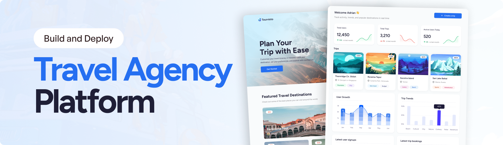

<div align="center">



<br />
<br />

<h1>🌍 Worldvisto</h1>

<p><strong>AI-powered travel planning, beautifully crafted.</strong><br/>
Plan personalised itineraries, discover destinations, and book your next adventure — all in one place.</p>

<br/>

[](https://react.dev)
[](https://reactrouter.com)
[](https://www.typescriptlang.org)
[](https://tailwindcss.com)
[](https://appwrite.io)
[](https://ai.google.dev)
[](https://stripe.com)
[](https://sentry.io)

</div>

---

## 📋 Table of Contents

- [✨ Features](#features)
- [🛠 Tech Stack](#tech-stack)
- [🗂 Project Structure](#project-structure)
- [🚀 Getting Started](#getting-started)
  - [Prerequisites](#prerequisites)
  - [Installation](#installation)
  - [Environment Variables](#environment-variables)
  - [Running the App](#running-the-app)
- [📱 Pages & Routes](#pages--routes)
  - [Public Routes](#public-routes)
  - [Admin Routes](#admin-routes)
  - [API Routes](#api-routes)
- [🤖 AI Trip Generation](#ai-trip-generation)
- [💳 Payments with Stripe](#payments-with-stripe)
- [🔐 Authentication](#authentication)
- [📊 Admin Dashboard](#admin-dashboard)
- [🌐 Deployment](#deployment)
- [🤝 Contributing](#contributing)

---

## ✨ Features

| Feature                            | Description                                                                        |
| ---------------------------------- | ---------------------------------------------------------------------------------- |
| 🤖 **AI Itinerary Generator**      | Powered by Google Gemini — creates full multi-day travel plans from a simple form  |
| 🗺 **Interactive World Map**       | Syncfusion-powered map lets admins visualise destination countries in real time    |
| 🖼 **Dynamic Photo Galleries**     | Auto-fetches stunning destination imagery from Unsplash                            |
| 💳 **Stripe Payment Integration**  | Travellers can book and pay for trips with a single click via Stripe payment links |
| 🔐 **Google OAuth Authentication** | Seamless one-click sign-in with Google via Appwrite OAuth2                         |
| 📊 **Real-time Admin Dashboard**   | Charts, stats, user growth, and trip-style analytics at a glance                   |
| 👥 **User Management**             | Paginated user table with role-based access control (user / admin)                 |
| 🗂 **Trip Management**             | Full CRUD for AI-generated trips — view, edit, and assign payment links            |
| 🎉 **Confetti Celebration**        | Animated confetti on successful payment for a delightful UX                        |
| 📡 **Error Monitoring**            | Sentry integration for real-time production error tracking                         |

---

## 🛠 Tech Stack

### Frontend

- **[React 19](https://react.dev)** — cutting-edge React with the new compiler
- **[React Router v8](https://reactrouter.com)** — file-based SSR routing (framework mode)
- **[Tailwind CSS v4](https://tailwindcss.com)** — utility-first styling with CSS-first config
- **[Syncfusion EJ2 React](https://www.syncfusion.com/react-components)** — charts, grids, maps, dropdowns, buttons
- **[TypeScript 7](https://www.typescriptlang.org)** — end-to-end type safety

### Backend & Services

- **[Appwrite](https://appwrite.io)** — authentication, database (TablesDB), storage
- **[Google Gemini AI](https://ai.google.dev)** (`gemini-3.5-flash-lite`) — natural-language itinerary generation
- **[Unsplash API](https://unsplash.com/developers)** — high-quality destination photography
- **[Stripe](https://stripe.com)** — product creation and hosted payment links

### Tooling

- **[Vite 8](https://vite.dev)** — lightning-fast build tool
- **[Sentry](https://sentry.io)** — error monitoring and performance tracking
- **[Zod v4](https://zod.dev)** — schema validation for API request bodies
- **[dayjs](https://day.js.org)** — lightweight date formatting
- **[canvas-confetti](https://github.com/catdad/canvas-confetti)** — celebration animations

---

## 🗂 Project Structure

```
travel_agency/
├── app/
│   ├── appwrite/           # Appwrite service layer
│   │   ├── auth.ts         # Google OAuth, user CRUD
│   │   ├── client.ts       # Appwrite SDK configuration
│   │   ├── dashboard.ts    # Stats & analytics queries
│   │   ├── server.ts       # Server-side session client
│   │   └── trip.ts         # Trip CRUD operations
│   ├── constants/
│   │   ├── index.ts        # App-wide constants & countries list
│   │   └── world_map.ts    # GeoJSON world map data
│   ├── lib/
│   │   ├── stripe.ts       # Stripe product & payment link helpers
│   │   ├── utils.ts        # Shared utility functions
│   │   └── validations/
│   │       └── trip.ts     # Zod schema for trip creation
│   ├── routes/
│   │   ├── admin/          # Admin-only pages (dashboard, trips, users)
│   │   ├── api/            # Server API action routes
│   │   └── root/           # Public-facing pages
│   ├── root.tsx            # App shell, global providers
│   └── routes.ts           # Route definitions
├── components/             # Shared UI components
│   ├── FeaturedDestination.tsx
│   ├── Header.tsx
│   ├── InfoPill.tsx
│   ├── MobileSidebar.tsx
│   ├── NavItems.tsx
│   ├── PaymentLinkPanel.tsx
│   ├── RootNavbar.tsx
│   ├── StatsCard.tsx
│   ├── TripCard.tsx
│   └── ToggleButton.tsx
├── public/
│   └── assets/
│       ├── icons/          # SVG icon library
│       └── images/         # Static images
├── vite.config.ts          # Vite + Sentry + React Compiler config
└── package.json
```

---

## 🚀 Getting Started

### Prerequisites

- **Node.js** ≥ 20
- **pnpm** (recommended) — `npm install -g pnpm`
- An **Appwrite** project with TablesDB enabled
- A **Google Cloud** project with OAuth credentials
- A **Gemini API** key
- An **Unsplash** developer account
- A **Stripe** account

### Installation

```bash
# Clone the repository
git clone https://github.com/your-username/travel_agency.git
cd travel_agency

# Install dependencies
pnpm install
```

### Environment Variables

Create a `.env.local` file in the project root:

```env
# Appwrite
VITE_APPWRITE_API_ENDPOINT=https://cloud.appwrite.io/v1
VITE_APPWRITE_PROJECT_ID=your_project_id
VITE_APPWRITE_DATABASE_ID=your_database_id
VITE_APPWRITE_USERS_TABLE_ID=your_users_table_id
VITE_APPWRITE_TRIPS_TABLE_ID=your_trips_table_id

# Google Gemini AI
GEMINI_API_KEY=your_gemini_api_key

# Unsplash
UNSPLASH_ACCESS_KEY=your_unsplash_access_key

# Stripe
STRIPE_SECRET_KEY=your_stripe_secret_key

# Sentry (optional)
SENTRY_AUTH_TOKEN=your_sentry_auth_token
```

> **Note:** Variables prefixed with `VITE_` are exposed to the browser. Never put secret keys in `VITE_` variables.

### Running the App

```bash
# Start the development server
pnpm dev

# Build for production
pnpm build

# Start the production server
pnpm start

# Lint the codebase
pnpm lint
```

The app will be available at **[http://localhost:5173](http://localhost:5173)** in development.

---

## 📱 Pages & Routes

### Public Routes

| Route              | Page            | Description                                                  |
| ------------------ | --------------- | ------------------------------------------------------------ |
| `/`                | Travel Page     | Hero section, featured destinations, and paginated trip grid |
| `/trips/:tripId`   | Trip Detail     | Full itinerary, photo gallery, weather, and payment button   |
| `/sign-in`         | Sign In         | Google OAuth sign-in card                                    |
| `/payment-success` | Payment Success | Confetti celebration page after a successful Stripe payment  |

### Admin Routes

> Accessible only to users with `status: "admin"` in the database.

| Route            | Page         | Description                                                        |
| ---------------- | ------------ | ------------------------------------------------------------------ |
| `/dashboard`     | Dashboard    | Stats cards, user growth chart, trip-style chart, user/trip tables |
| `/trips`         | All Trips    | Manage and browse all AI-generated trips                           |
| `/trips/create`  | Create Trip  | AI trip generation form with live world map preview                |
| `/trips/:tripId` | Trip Details | Admin view of a specific trip with payment link management         |
| `/all-users`     | All Users    | Paginated user table with role badges                              |

### API Routes

| Endpoint                  | Method | Description                                                                                                 |
| ------------------------- | ------ | ----------------------------------------------------------------------------------------------------------- |
| `/api/create-trip`        | `POST` | Validates request, calls Gemini AI, fetches Unsplash images, saves to Appwrite, creates Stripe payment link |
| `/api/retry-trip-payment` | `POST` | Retries Stripe product/payment link creation for an existing trip                                           |

---

## 🤖 AI Trip Generation

The trip generation pipeline is fully server-side and secured with JWT authentication:

```
Client Form Submit
      │
      ▼
  POST /api/create-trip
      │
  1. Verify Appwrite JWT (server-side)
  2. Check admin role in DB
  3. Validate request body with Zod
      │
      ▼
  Google Gemini (gemini-3.5-flash-lite)
  → Generates structured JSON itinerary
      │
      ▼
  Unsplash API
  → Fetches 3 destination photos
      │
      ▼
  Appwrite TablesDB
  → Saves trip + image URLs
      │
      ▼
  Stripe
  → Creates product + hosted payment link
      │
      ▼
  Response: { id: tripId }
```

**AI Prompt inputs:** country, number of days, travel style, interests, budget, group type.

**AI Output includes:** trip name, description, estimated price, full day-by-day itinerary with morning/afternoon/evening activities, best time to visit (all 4 seasons), and weather info.

---

## 💳 Payments with Stripe

Each generated trip automatically gets a **Stripe product and a hosted payment link**. When a user clicks _"Pay to join the trip"_, they are redirected to Stripe Checkout. On success, they land on `/payment-success` with a confetti animation.

The payment link is stored in Appwrite alongside the trip, so it is reused on every subsequent visit — no duplicate Stripe products are created.

---

## 🔐 Authentication

Authentication is handled via **Appwrite OAuth2** with Google as the provider:

1. User clicks **"Sign in with Google"** → triggers `account.createOAuth2Session()`
2. On success, Appwrite redirects back to `/`
3. The app calls `account.get()` to retrieve the session
4. User data (name, email, avatar) is stored in the Appwrite `users` table on first login
5. For server actions, a **short-lived JWT** (`account.createJWT()`) is generated client-side and verified server-side via `createSessionClient(request)` — keeping secrets off the client

---

## 📊 Admin Dashboard

The dashboard aggregates live data from Appwrite and renders it with **Syncfusion charts**:

- **Stats Cards** — total users, total trips, active users (with month-over-month delta)
- **User Growth Chart** — column + spline area combo chart (day-by-day new signups)
- **Trips by Travel Style** — column chart showing distribution across travel styles
- **Latest Users Table** — newest signups with avatar and trip count
- **Trips by Interest Table** — recent trips with interest category

---

## 🌐 Deployment

The app is built with **React Router framework mode** (SSR) and served via `@react-router/serve`.

```bash
# Production build
pnpm build

# Start production server
pnpm start
# Runs: react-router-serve ./build/server/index.js
```

For cloud deployment, any Node.js-compatible host works (Railway, Render, Fly.io, etc.). Ensure all environment variables are set in your hosting provider's dashboard.

---

## 🤝 Contributing

Contributions are welcome! Here's how to get started:

1. **Fork** the repository
2. **Create** a feature branch: `git checkout -b feature/your-feature`
3. **Commit** your changes: `git commit -m 'feat: add your feature'`
4. **Push** to the branch: `git push origin feature/your-feature`
5. **Open** a Pull Request

Please make sure your code passes `pnpm lint` before submitting.

---

<div align="center">

Made with ❤️ and ☕ — happy travelling!
<br />
Thanks to JS Mastery

</div>
